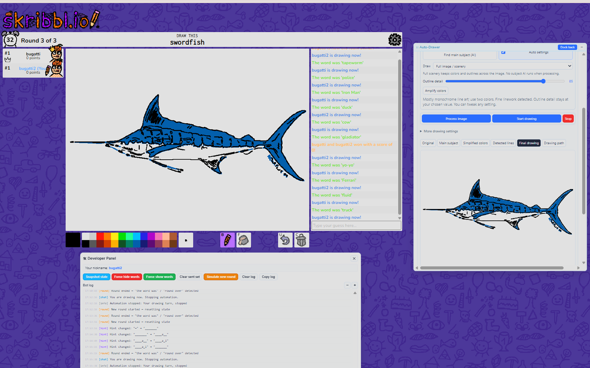
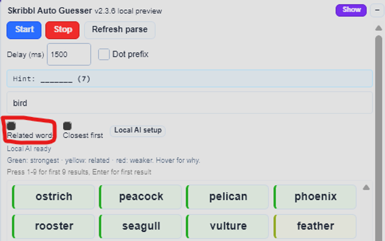
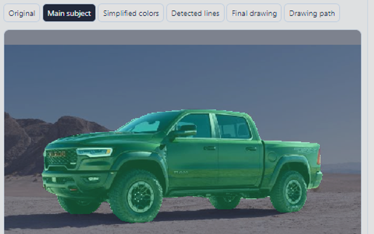
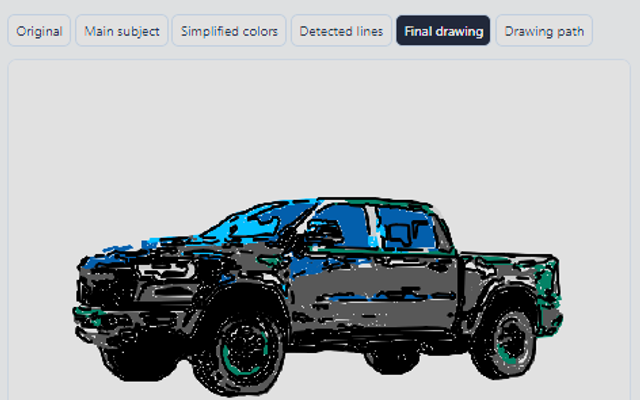

# Skribbl Auto Guesser + Auto Drawer

Hint-aware word suggestions and an image Auto-Drawer for **skribbl.io**. Search by spelling or meaning, preview an uploaded image, and choose when to send guesses or start drawing. Optional AI runs on your own computer.

**Version 2.3.7** · Chrome 116+ · No paid AI subscription or API key required.

Version 2.3.7 includes the debugger startup pause, corrected Web Store packaging and an independent Outline detail control. The Chrome Web Store submission is awaiting review.

[How to use](docs/USAGE.md) · [AI setup](docs/USAGE.md#choose-an-ai-engine) · [Privacy](PRIVACY.md) · [Report a problem](https://github.com/chenhexu/skribbl-cheats-extension/issues)

Real user captures show drawing and search in use. [Screenshot gallery and originals](store/SCREENSHOTS.md).

## Install

1. Download `skribbl-auto-guesser-2.3.7.zip` from [GitHub Releases](https://github.com/chenhexu/skribbl-cheats-extension/releases/tag/v2.3.7).
2. Extract it into a permanent folder. The ZIP contains the extension and its AI models; you do not need Python or npm to use it.
3. Open `chrome://extensions`, turn on **Developer mode**, click **Load unpacked**, and select the extracted folder containing `manifest.json`.
4. Open or refresh [skribbl.io](https://skribbl.io/). The helper panel appears on that site. Disable any older installed copy to avoid duplicate panels.

When updating, replace the extracted files, click **Reload** on the extension card, then refresh existing Skribbl tabs. Chrome AI requires a supported browser/device; use Chrome CPU if GPU acceleration is unavailable.

The repository source excludes large generated AI binaries. To load a source checkout, follow [Development](docs/DEVELOPMENT.md) first. The Chrome Web Store listing is awaiting review; no store installation link is available yet.

## Search and guess

- The panel reads the current hint, including revealed letters and multiword lengths. Suggestions always stay inside that eligible word bank.
- Type to search. Enable **Related words** for spelling, categories and optional semantic AI: for example, `fish` can find eligible ocean animals and `animal` can include related parts or phrases such as `tail` or `bear trap`.
- Enable **Closest first** to rank results, or turn it off for alphabetical order. Green, yellow and red indicate match strength; hover to see why a word matched. These colors are relevance cues, not answer probabilities.
- Click a suggestion to send it. **Enter** sends the first result; **1–9** sends the corresponding visible result. **Start** enables automatic guessing with your chosen delay; **Stop** stops it.
- Spam warnings pause sending. Rejected guesses are not treated as accepted chat messages. Wait for the cooldown before retrying; a new drawing round clears the search.

## Draw an image

1. Expand **Auto-Drawer**, choose **Colors + outlines**, and upload or drop an image. A small original appears above the controls.
2. For landscapes, leave **Use main subject** off and choose **Full image / scenery**. For an object, enable it and choose a subject/background mode. **Process image** automatically finds a subject when needed; you can also mark or edit the selection manually.
3. Enable **Auto settings** to choose per-image color and processing settings. **Outline detail stays under your control.** Editing a suggested setting turns Auto off and keeps the other suggested values.
4. Click **Process image**. Inspect **Simplified colors**, **Final drawing** or **Drawing path**. Adjust the selection, color count, amplification or detail and process again if needed.
5. During your drawing turn, click **Start drawing** in the Skribbl panel. Use **Stop** to end the run. Chrome displays its debugger notice while the drawer sends trusted canvas input.

**Fast** speed and a shorter drawing target reduce small details. **Balanced** keeps more detail. Thick lines use a wider pencil when it can reproduce their shape safely, reducing contour tracing and bucket clicks. Color count is a maximum of **24** per layer; similar shades can merge. **Amplify colors** can reveal dark hues before palette simplification. Subject-first ordering helps draw the selected object before optional background details.

Drag the drawer out of its dock for more room; it expands automatically. **Dock back** returns it. **Open large viewer** provides a bigger image editor with crop/selection tools; actual game drawing starts from the Skribbl panel.

| Main subject selection | Planned drawing |
| --- | --- |
|  |  |

## Choose an AI engine

Open **Local AI setup** from the drawer or below the word search. Choose an engine, then load/check it before playing.

| Engine | What you need | Best fit |
| --- | --- | --- |
| **Inside Chrome — GPU acceleration** | WebGPU supported by Chrome and your graphics driver | Faster subject and line inference on supported devices |
| **Inside Chrome — CPU** | A supported Chrome browser | No terminal; works when GPU is unavailable |
| **Python service — terminal** | The companion source project and a running service | Existing Python setups; CUDA may also be used |

For Chrome modes, click **Load AI models** and wait for the three features to report ready. **Test word-search speed** measures your device; first loading/compilation takes longer than later searches. The saved engine is shared by search and drawing. The default remains Python until you choose another engine.

AI provides meaning-based word suggestions, U2NETP foreground masks and Informative Drawings line detection. These are trained neural networks, not reinforcement learning or a hosted chat service. Auto settings, Browser line detection, category matching and manual subject selection use ordinary local algorithms. AI can miss parts or suggest weak associations; review the preview and edit it.

See the [usage guide](docs/USAGE.md) for subject corrections, terminal setup and troubleshooting.

## Privacy and permissions

Chrome AI uses packaged models on your device. No hosted inference provider, analytics collector or API token is used. Guesses and drawing input go to Skribbl; optional public word-list downloads contact GitHub/jsDelivr. Python mode contacts only your local service after permission is granted. See the [privacy policy](PRIVACY.md) for storage and network details.

Only `storage` and `debugger` are required: they remember shared preferences and perform user-started game drawing. `offscreen` is optional and requested when enabling Chrome AI. Site scripts run only on `https://skribbl.io/*`; optional Python access is limited to `http://127.0.0.1:8765/*`. See the [permission audit](docs/STORE_PERMISSIONS_AUDIT.md) for the API uses and checks.

## Development and publishing

[Development and builds](docs/DEVELOPMENT.md) · [Project folders](docs/PROJECT_LAYOUT.md) · [Release notes](CHANGELOG.md) · [Chrome Web Store submission kit](store/README.md) · [Permission justifications](STORE_PRIVACY_FIELDS.md) · [2.3.7 validation](docs/VALIDATION_2.3.7.md)

Project code is [MIT licensed](LICENSE). Bundled models and third-party runtime components retain their own licenses; see [third-party notices](THIRD_PARTY_NOTICES.md). This project is independently developed and is not affiliated with Skribbl or Google.
